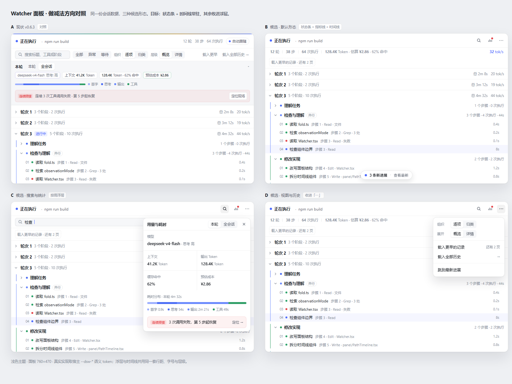

[中文](./README.md) · English

# Watcher

[](https://github.com/daha1216/dsh-watcher/actions/workflows/ci.yml)

## Install

### DSH Studio desktop app (recommended)

Open **Settings → Plugins → Add plugin** and enter this in “Package name or address”:

```text
github:daha1216/dsh-watcher#v0.7.2
```

The desktop plugin manager owns the Desktop profile and bundled package manager. This release commits `lib/`; normal use needs no clone, build, or DSHX installation. Follow the app if it asks you to reload or reopen after installation.

### Web CLI

```sh
dsh plugin --profile web add github:daha1216/dsh-watcher#v0.7.2
```

This official CLI command writes only the `web` profile; it cannot modify the Desktop App profile. For an already-running Web Host, reopen that Host once and reload the page.

DeepSeek Harness **0.2.x** (verified against `0.2.1-rc.3`). The peer range `>=0.1.7-rc.1 <0.1.8 || ^0.2.0-rc.1` accepts **0.1.7-rc.1**, **0.1.7-rc.2**, and the **0.2.x** line; 0.3.0 and above are refused by the plugin manager with `incompatible-version` (add a `dsh plugin allow-version` exemption to try anyway), and once DSH reaches 0.3.x this plugin needs a new release to widen the range. Node `^22.19.0` or `>=24`.

A read-only plugin for DeepSeek Harness Web. Open the eye in the session header. A Session becomes a foldable work path: how many steps ran, how many tools fired, how long it took. Open a step for parallel branches, a tool result, or a reasoning row that stays folded until you ask.

It does not inject messages, invent hidden chain-of-thought, or replace the official Trajectory.


> The screenshots are from 0.6.2. Two header passes have landed since (the 0.6.3 command bar, then the 0.7.0 status bar, flat usage readout and foldable execution path), so the captures are further behind than the text.



Grouped view only stacks what it can prove. Two different bash calls stay apart. The model stage shows only provider-visible reasoning already written into the Session. If nothing was recorded, it says so.

From a clone (development/local testing):

```sh
git clone https://github.com/daha1216/dsh-watcher.git
dsh plugin --profile web add ./dsh-watcher
```

That path also needs pnpm, then reopen that Web Host and reload the page.

```sh
dsh plugin --profile web remove dsh-watcher
```

The public CLI manages `web` only; use the in-app “Add plugin” entry above for the Desktop App.

The settings summary and session HUD show **Estimated cost** (not “total value”) next to total tokens. Input / output / cache buckets are priced from `pricing/models.yaml`. A missing row is **Unknown**, never $0. The table's `unit` (per million / per thousand tokens) and each row's `currency` are honoured: a non-USD row prints its own currency sign, a mixed-currency scan refuses the total instead of converting, and a partial estimate keeps the known amount in the main number and footnotes **Some models unpriced**. It is an estimate, not a bill. The default table covers mainstream DeepSeek, MiniMax, OpenAI, Anthropic, Gemini, Grok, GLM, and Qwen rows and is static (no live fetch). Override it in Watcher settings (`localStorage` key `dsh-watcher:pricing-override:v1`). PRs to the default table are welcome.

The interaction contract lives in [DESIGN.md](./DESIGN.md). MIT.

## What's new (0.7.2)

- **An adversarial audit.** Five read-only review lanes plus a replay of real session logs fixed twenty-odd crashes, mispriced costs, privacy leaks and lifecycle defects. The biggest one: repeated-failure evidence never fired on the real Host shape (none of 10,951 recorded `tool/result` events carried a `tool-result` block). Results now settle from `message.isError` / `message.toolCallId`, and the failure counts of three real sessions match the recorded `isError` flags exactly.
- **No more stack overflow, no more NaN.** A call or result nested thousands of levels deep no longer raises `RangeError` inside the render memo; a chunk without a usable timestamp no longer writes `undefined` / `NaN` into the projection, an abandoned attempt settles at its last content time, and an overnight pause is no longer booked as hours of model time.
- **Cost is priced correctly.** `per_1k_tokens` is no longer charged at the per-million divisor (a 1000x overestimate), a row's currency sign is honoured, a mixed-currency scan refuses the total, and a corrupted pricing override no longer breaks the settings page or the panel.
- **Long sessions stay responsive.** The open panel no longer refolds the whole session on every streaming delta (a 20k-event session folds in ~130 ms); live folds coalesce at a rate that backs off with the measured cost and the settled turn folds immediately.
- **Privacy boundaries.** Remote images in recorded markdown render as links, so opening a record no longer fetches a third-party URL chosen by a model or a fetched file; the raw tab and absolute paths stay exact by contract, and the boundary is documented in DESIGN.md.
- **Interaction and edges.** Esc no longer collapses the panel while the inspector exits, arrow keys are inert while the tools menu is open, a search filter no longer makes the fold chevron inert, following restores itself at the bottom of the rail, DST zones no longer duplicate or drop a calendar column, and 59.96 s reads `1 分 0 秒`.

## 0.7.1

- Verified against DeepSeek Harness **0.2.1-rc.3**; the compatibility note now tracks the **0.2.x** line (peer range unchanged: `>=0.1.7-rc.1 <0.1.8 || ^0.2.0-rc.1`). 0.3.0 and above are refused by the plugin manager as `incompatible-version`.

## 0.7.0

- **The panel subtracts so the path can lead.** The permanent command bar, path toolbar and whole-session HUD are gone. Three things stay: a 44px status bar (state dot, state word, current action, plus search / usage / view icon buttons), a 26px borderless scale line (turns · steps · executions; tokens · estimated cost · cache hit; live tok/s on the right), and the timeline. Search and the 全部 / 异常 / 等待 filter open under the header, usage opens in a popover, and organize / depth / load-older / load-all / jump-to-latest live in the ellipsis menu.
- **One row per record.** Turn headers are 33px, phase headers 30px and record rows 26px. A Step with exactly one record and no model stage flattens into that record row — its step number moves into the meta line — instead of spending a header on a single row. Turn total, phase span, record time and live tok/s stay visible; the phase duration-share bar is gone.
- **The client is split to match.** New `src/client/panel/`: `panel-model.ts` holds the pure view model (filter projection, Step flattening, meta / signal / cluster copy), while `PanelHeader`, `MetricsStrip`, `SearchRow`, `ViewMenu`, `StatsPopover`, `PathTimeline`, `TurnSection`, `PhaseSection` and `OccurrenceRow` each own one region. `Watcher.tsx` keeps only state and composition (795 lines) and `Overview.tsx` is deleted. `Watcher.module.css` drops from 1992 to 989 lines, keeping only the shell, inspector, model stage and resize handles.
- **The contract follows the structure.** The presentation contract now pins the three tool buttons and three `data-watcher-overlay` regions, the single flat `SessionInsights`, which border belongs to the status bar, flattened Steps and cluster folding; `tests/panel-model.test.mjs` covers the new pure view model.
- **Structure and visual pass (unreleased earlier).** `Watcher.tsx` went 2029 → 795 lines; `Insights.tsx` (2142 lines) split into a session HUD, the settings page, the inspector, the overview, the model stage, an analytics module and six `insights-sections/` files. The style modules went from three to five, one of them a shared vocabulary.
- **One semantic vocabulary.** Every style module reads the `--ui-*` alias layer in `src/client/ui/tokens.module.css`: hard-coded hex is at zero, nothing references `--dsw-static-*` directly, and no `var(--dsw-*, fallback)` pair remains. The layer is mounted as a class on each client root (cross-file `composes` does not survive the plugin's css-modules build), so theme tokens still inherit down.
- **Host primitives where the host has one.** The settings save/refresh actions and the numeric limits now use `Button` and `Input` from `@deepseek-ai/dsh-client-ui-primitives`, and a new `ui/SegmentedToggle` reproduces the host segmented-control recipe for the organize/depth, scope, model and range switches. It is a labelled `role="group"` of toggle buttons rather than the host `SegmentedControl`: those switches change how the same content renders and own no panel to name in `aria-controls`.
- **Depth is one host elevation token and one border again.** The local bevel highlight, the stacked contact/main/ambient shadows and the decorative chart glows are gone; hover uses host fills and the focus ring.
- **Accessibility.** The HUD headline cards and ledger rows were clickable `div`s unreachable by keyboard and are now real buttons; prose labels sit at the host 11px floor, small controls grew to a 24px hit target, and the heatmap crosshair is an outline rather than a colour filter.
- **The settings page no longer recomputes analytics in the render path:** aggregation, distributions and the ledger are derived once per scan and only rebuild when the scan or the range changes.
- **A failed scan reports itself** instead of rendering like an empty ledger, a first scan is told apart from "nothing recorded yet", and sessions the scan left out are named in the totals footnote.
- **Work-category colour stays on the path.** Each phase still owns a hue, now painted only on its marker dot and its 2px left rail; running state and live tok/s use the host business blue, and the brand ink is reserved for selection.
- **The inspector no longer repeats the path.** It keeps the header, metrics and 结果/输入/原始 tabs, and gains a record stepper — 上一条 / 下一条 plus a `记录 K/M` position, wired to the arrow keys — so records can be walked without going back to the path. The detail tabs now carry `id`/`aria-controls`/`tabpanel` semantics.
- **Escape is layered.** With a record open it closes only the inspector and returns focus to the path; with none open it closes the panel. Arrow keys move between records while the inspector is open, except inside inputs and editable content.
- **Wide panels split.** Past 980px the inspector docks beside the path instead of covering it; narrower panels keep the overlay drawer. The threshold is measured on the panel with a `ResizeObserver`, not a viewport media query.
- **The settings page is four tabs** — 概览 / 趋势 / 会话 / 偏好 — instead of one long dashboard. The time-range control hides on 偏好, and drilldowns open as a dialog over the page (backdrop, Escape, focus restored to the card that opened it).
- **The session ledger** gained a search box, a 显示更多会话 pager (ten rows at a time) and a total-count footnote; the sort control stays in the header row.
- **Dead styles removed** with the old panel (command bar, toolbar, HUD, old phase/turn rules and dangling selectors); the contract test now asserts durations and states where they render.

## What's new in 0.6.3

- **The panel is a solid instrument.** Frosted glass is gone: opaque body, 1px scribe border, top bevel highlight and a layered shadow stack; the chart tooltip and timing card share the same surface variables.
- **The header is a two-row command bar.** A status line (dot, state, live action, follow) sits over a sunken control row (counts and history loader, organize/depth segments). Turns read as chapters, and the inspector is a covering right drawer instead of a pushing column — the work path never reflows and the panel keeps its width.
- **Phase rows fit on one line.** The 80–100px two-deck header became a 34px row (marker, chevron, title and badges, right-aligned step/execution/duration counters) with the full wording in the aria-label, plus a 2px duration-share bar at its base. The same panel height holds about 2.5× more rows.
- **One visual system for the settings page and HUD.** Four equal metric tiles, semantic-coloured insight cards, emoji-free drilldowns, and hard-coded hex accents replaced with dsw tokens and `color-mix`.
- **Folded content no longer costs DOM.** Collapsed subtrees render on demand, an idle panel stops walking historical subtrees every second, and only the executing phase subscribes to the 1Hz tick.
- **Faster and bounded.** Folding a real 3,409-event session is 37% faster (35.4ms → 22.1ms) with byte-identical output; the panel no longer folds while closed; the retained-occurrence merge and the stale-seq diagnostic set are capped.
- **Compat and tooling.** Peers widened to `>=0.1.7-rc.1 <0.1.8 || ^0.2.0-rc.1`, and a GitHub Actions workflow now runs typecheck, build and test.

## 0.6.1

- Checked on official DeepSeek Harness **0.1.7-rc.2**. `@deepseek-ai/dsh-*` peers stay `>=0.1.7-rc.1 <0.1.8`, so install accepts `0.1.7-rc.1` and `0.1.7-rc.2` and rejects `0.1.7-alpha.*`.
- Icons stay `IconChevronRightOutlineRegular`, `IconRefreshOutlineRegular`, `IconCheckOutlineRegular`, and `IconCopyOutlineRegular`. rc.2 still does not export the size-suffixed names.

## 0.6.0

- Targets official DeepSeek Harness **0.1.7-rc.1**. `@deepseek-ai/dsh-*` peers are `>=0.1.7-rc.1 <0.1.8`, so install accepts `0.1.7-rc.1` and rejects `0.1.7-alpha.*`.
- Icons are `IconChevronRightOutlineRegular`, `IconRefreshOutlineRegular`, `IconCheckOutlineRegular`, and `IconCopyOutlineRegular`. rc.1 removed the size-suffixed exports and ships no aliases.

## 0.5.0

- **The panel resizes.** Drag the right edge, the bottom edge, or the corner grip; the frame stays put while it grows, and it can never shrink below the size it opened at.
- **The HUD folds to one line.** A `▾` next to the scope switch collapses the timing panel to just the top bar, and the choice is remembered.
- **"定位现场" lands on the actual failure.** It now selects the exact failing step and opens the inspector on it instead of scrolling to a bare turn header.
- **Repeated failures no longer stack.** One failure chain updates one card, and the title names its turn (`第 N 轮`).

Plus the 0.4.5 fixes: the inspector back control no longer re-arms follow, the first range pick no longer rescans sessions, the projection state no longer stores a copy of its own view, and the timing panel's non-terminal slice is labelled correctly.

Older releases: [CHANGELOG.md](./CHANGELOG.md).

## Build from source

Skip this for a normal install. Rebuild the committed `lib/` with **pnpm** after TypeScript changes:

```sh
pnpm install
pnpm test
node scripts/link-harness-dependencies.mjs /path/to/harness
pnpm build
```

`pnpm build` needs a local Harness checkout that can resolve the `@deepseek-ai/dsh-*` peers. Do not use this path to install the plugin.

Watcher waits for the Chat projection on cold sessions before mounting its panel.
